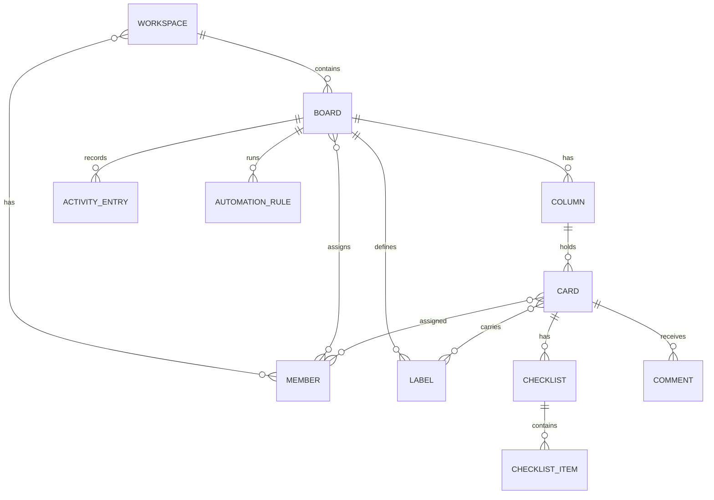
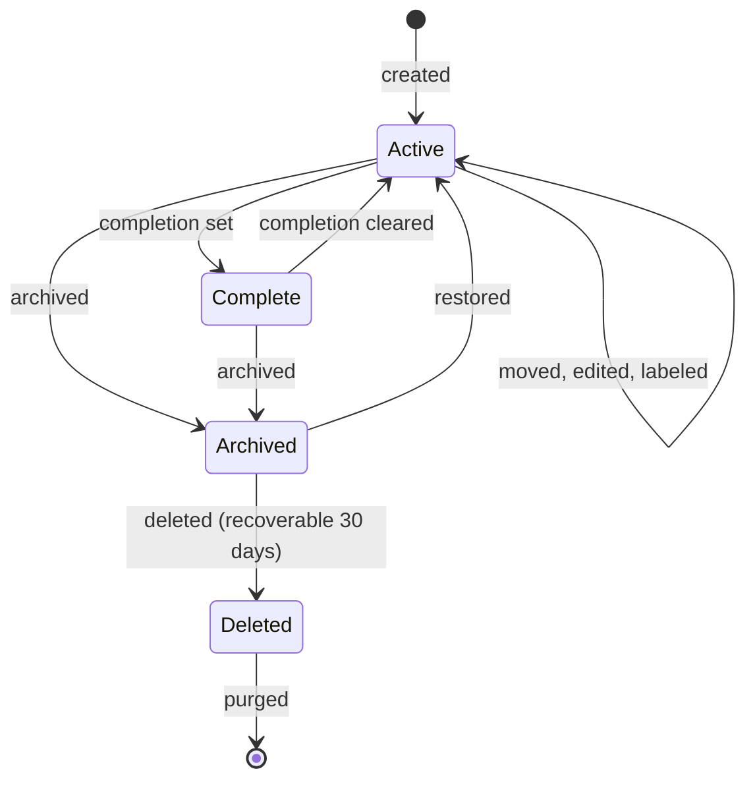

# Domain model

## Entities

| Entity | Key fields | Relationships |
|---|---|---|
| Workspace | name, plan, quotas | 1..N boards, N..M members |
| Board | title, visibility | 1 workspace, N columns, N labels, N members, N guests |
| Column | title, position, archived | 1 board, N cards |
| Card | title, description, position, archived, deleted-at | 1 column, N labels, N members, N checklists, N comments |
| Label | name, color (10 fixed) | 1 board, M..N cards |
| Checklist | title, position | 1 card, N items |
| ChecklistItem | text, done, assignee, due | 1 checklist |
| Comment | body, author, created | 1 card |
| ActivityEntry | actor, action, entity, timestamp | immutable, per board and card |
| AutomationRule | trigger, actions (1..3), enabled | 1 board |
| SavedFilter | name, criteria | 1 member |

## Relationships

## Card state machine

## Business rules

1. A card belongs to exactly one column at a time.
2. Column and card order is a dense position sequence; moves resequence deterministically.
3. Labels are defined per board; a card carries only its board labels.
4. The activity log is append-only; entries are never edited or deleted.
5. Automation rules execute at most once per triggering event.
6. Quota checks run before the operation; quota breaches fail with the limit stated.
7. Archive is reversible; delete is recoverable for 30 days, then purged.
8. Guests access exactly one board and inherit the member role there.

## Edge cases

- Two members move one card simultaneously: last write wins per move; activity log records both.
- A rule moves a card to an archived column: the action is skipped and logged.
- A checklist item assignee loses board access: the assignment is cleared, the item remains.
- Position collision after offline sync: fractional midpoint positions resolve, then resequence.
