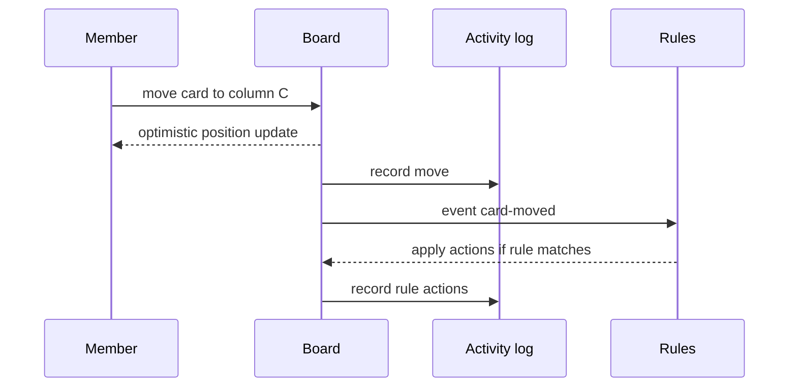

# Flows

## F1 First board

Owner opens workspace, creates a board with title and visibility, receives three default columns, adds a card to the first column.

## F2 Move a card

Member drags a card from one column to another, or focuses the card and uses keyboard move commands. The board updates immediately and the move is recorded in the activity log.

## F3 Find work

Member opens search, types a title fragment, narrows by label and due state, saves the filter under a name, and reuses it from the filter list.

## F4 Discuss a card

Member opens a card, writes a comment, mentions the card state in discussion, and closes the card. The comment appears in the card and the board activity log.

## F5 Automate a column

Owner creates a rule: when a card is moved to the final column, mark it complete and archive it after zero to three actions. The rule runs on the next matching event.

## F6 Invite a guest

Owner on a paid plan invites a guest by address, selects one board, the guest receives access to that board only.

## Neutral wireframes

Board view:

```
[header: board title | search | filter | members | view switch]
[column: title]   [column: title]   [column: title]
  card             card                card
  card             card                card
  + add card       + add card          + add card
[activity side panel: actor, action, time]
```

Card detail as overlay:

```
[title]
[description]
[members] [labels] [due date]
[checklist: item 1, item 2, progress percent]
[comments: author, body, time]
[actions: move, copy, archive]
```


